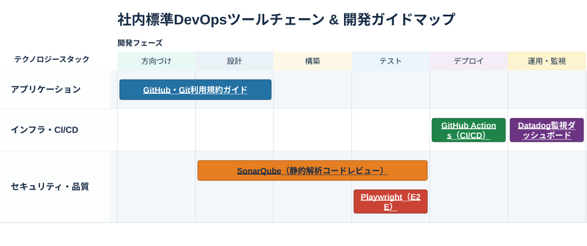

<div align="center">

# 📊 matrix-renderer

</div>

## Overview / 概要

**A tool that generates matrix image files (PNG/SVG) from YAML.**

YAMLからマトリクスイメージファイル（png/svg）を生成するCLIツールです。  

**指定可能な値**
* タイトル
* イメージ幅
* X軸のラベル、テキスト、色
* Y軸のラベル、テキスト、色
* プロットするアイテムのテキスト、配置行、X軸に対応した幅指定、色、URL



## Environment / 動作環境

* Node.js 24+

## 🚀 How to use / 利用手順

1. マトリクス設定ファイルを作成する
   マトリクスを作成するための設定値を定義したファイルを作成します。
      * テンプレートは[こちら](#️-yaml-template--yaml設定テンプレート)
      * サンプルは[こちら](#️-sample--サンプル)
2. イメージファイルを生成する
   用途に合う[コマンド](#-command--コマンド)を使用してイメージファイルを生成します。

## ⌘ Command / コマンド

イメージファイルを生成するコマンド例です。

### 入力ファイルのみ指定

ルートディレクトリに入力ファイルと同名のイメージファイルを生成します。

```sh
npx matrix-renderer render -- example.yaml
```
* 📁
  * example.yaml
  * example.png
  * example.svg

### 入力ファイル、出力ファイル名指定

ルートディレクトリに指定されたファイル名のイメージファイルを生成します。

```sh
npx matrix-renderer render -- example.yaml --out rename
```
* 📁
  * example.yaml
  * rename.png
  * rename.svg

### 入力ファイル、出力ディレクトリ+ファイル名指定

指定されたディレクトリ配下に、指定されたファイル名のイメージファイルを生成します。

```sh
npx matrix-renderer render -- example.yaml --out output/rename
```
* 📁
  * example.yaml
  * 📁output
    * rename.png
    * rename.svg

### ヘルプ

CLIのヘルプ表示。

```sh
npx matrix-renderer render -- --help

Usage:
  matrix-renderer render <input.yaml> [--out <output-prefix>]

Options:
  --out <prefix>  Output path without an extension (writes .svg and .png)
  -h, --help      Show this help
```

## 🛠️ YAML template / YAML設定テンプレート

```yaml
title: テンプレートです # * マトリクスタイトル
width: 800 # マトリクスの幅
xAxis: # * X軸
  label: X軸の説明 # * x軸のラベル
  values: # * X軸の設定
    - label: 列１ # * X軸のラベル
      color: "#d6eaf8" # 列の色（RGBまたはRRGGBB形式）
    - 列２ # * X軸のラベル　※色指定しない場合
    - label: 列３
      color: "#f4e2ad"
yAxis: # * Y軸
  label: Y軸の説明 # * Y軸のラベル
  values: # * Y軸の設定
    - label: 行１ # * Y軸のラベル
      color: "#c5e4ec" # 行の色（RGBまたはRRGGBB形式）
    - 行２ # * Y軸のラベル　※色指定しない場合
items: # * プロットするアイテムの設定
  - id: item1 # * アイテムのID
    label: アイテム１ # * アイテムのラベル
    lane: 行１ # * アイテムを配置する行（Y軸のラベルを指定）
    from: 列１ # * アイテムを配置する開始列（X軸のラベルを指定）
    to: 列１ # * アイテムを配置する終了列（X軸のラベルを指定）
    url: https://example.com/guide # アイテムのリンク
    color: "#245080" # アイテムの色（RGBまたはRRGGBB形式）
```
* X軸
  * 描画順: xAxis.valuesに定義された順に描画します
* Y軸
  * 描画順: yAxis.valuesに定義された順に描画します
* アイテム
  * from, to: アイテムの描画範囲。fromはtoより左にあたるラベルまたは同値でなければいけません。
  * URL: アイテムに埋め込みます。クリックすると新しいタブで開きます。（HTTPまたはHTTPS）※SVGのみ

## 🛠️ Sample / サンプル

[`examples/`](examples/)に入力ファイル、  
[`output/`](output/)に生成したイメージファイルを格納しています。

## 📄 License / ライセンス

[MIT License](LICENSE) © 2026 ubata-mamezou
