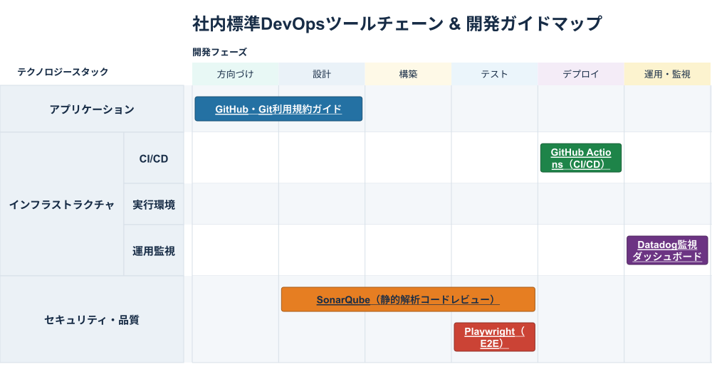
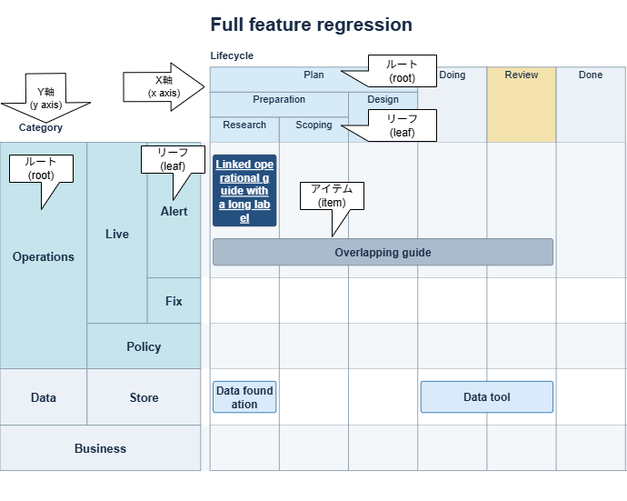

<div align="center">

#  matrix-renderer

<!-- バージョン & パッケージ情報 -->
[](https://www.npmjs.com/package/matrix-renderer)
[](https://www.npmjs.com/package/matrix-renderer)
[](https://www.npmjs.com/package/matrix-renderer)
[](https://www.npmjs.com/package/matrix-renderer)

<!-- テスト & カバレッジ -->
[](https://github.com/ubata-mamezou/matrix-renderer/actions/workflows/publish.yaml)
[](https://github.com/ubata-mamezou/matrix-renderer)

<!-- セキュリティ -->
[](https://socket.dev/npm/package/matrix-renderer)
[](https://snyk.io/test/npm/matrix-renderer)
[](https://www.npmjs.com/package/matrix-renderer)

</div>

## Overview / 概要

**A tool that generates matrix image files (PNG/SVG) from YAML.**

**Tired of updating matrix diagrams (feature matrices, roadmaps, dependency tables) in Excel or drawing tools? They easily get outdated and are impossible to track via Git diffs.**
**matrix-renderer allows you to manage your matrix data in plain YAML and automatically renders structured images (PNG/SVG). Keep your documentation close to your code and fully automated.**

YAMLからマトリクスイメージファイル（png/svg）を生成するCLIツールです。  

マトリクス図（カバレッジ表、機能一覧、ロードマップなど）をExcelやDraw.ioで管理していませんか？それ、すぐに古くなり、Gitでの差分管理もできません。
matrix-rendererは、プレーンなYAMLテキストをGitで管理するだけで、構造化されたマトリクス画像（PNG/SVG）を自動生成します。コードとドキュメントの乖離をなくし、ドキュメンテーションを自動化（Doc as Code）するための軽量ツールです。



**指定可能な値**
* タイトル
* イメージ幅
* X軸のラベル、テキスト、色、段組み
* Y軸のラベル、テキスト、色、段組み
* プロットするアイテムのテキスト、配置行、X軸に対応した幅指定、色、URL、アイテム間の前後関係

## glossary / 用語



* X軸: X軸方向にあたるラベルのこと。マトリクスの列に該当します。
* Y軸: Y軸方向にあたるラベルのこと。マトリクスの行に該当します。
* アイテム: マトリクス内に配置するボックスのこと。
* ルートラベル: 最上部に位置するラベルのこと
* リーフラベル: 最下部に位置するラベルのこと

## ✨ Key Features / 主な特徴

* Git-Friendly (Doc as Code): マトリクス構造をYAMLで記述するため、差分（diff）が明確で、レビューやバージョン管理が容易です。
* CI/CD Integration Ready: GitHub ActionsなどのCIワークフローに組み込むことで、YAMLの変更を検知してイメージファイルを自動で再帰的にアップデート可能です。
* Interactive SVG: 生成されたSVG内のアイテムにはハイパーリンクを埋め込み可能。ドキュメントから詳細ページへの動線を作れます。

## Effective Usage and Important Considerations / 効果的な使い方と注意点

* **YAMLをマスターにする**: 変更はYAMLへ反映し、画像はいつでも再生成できる成果物として扱ってください。
* **出力形式を使い分ける**: 拡大しても鮮明でリンクも利用できるSVGと、SVGを許可しない環境でも表示しやすいPNGを用途に応じて選択してください。
* **リンクの公開範囲を確認する**: SVGのリンク先が、図を見る利用者がアクセスできるURLか確認します。SVGの表示環境によってはリンクが制限される場合があります。
* **図の適正な大きさを保つ**: 項目や軸ラベルを増やしすぎると、画像が読みにくくなるため、情報量が多い場合は複数のマトリクスへ分割してください。
* **生成物の管理方針を決める**: 画像をGitへコミットする方法と、CI/CDで生成して公開成果物に含める方法があります。YAMLと画像の不整合を避けるため、どちらを正とするかチームで統一します。

## Environment / 動作環境

* Node.js 24+

## 🚀 How to use / 利用手順

1. マトリクス設定ファイルを作成する
   マトリクスを作成するための設定値を定義したファイルを作成します。
      * テンプレートは[こちら](docs/ja/template.md)
      * サンプルは[こちら](#️-sample--サンプル)
2. イメージファイルを生成する
   用途に合う[コマンド](docs/ja/command.md)を使用してイメージファイルを生成します。

## ⌘ Command / コマンド

イメージファイルを生成するコマンド例です。  
使用可能なコマンドパターンは[こちら](docs/ja/command.md)を参照してください。

```sh
npx matrix-renderer render -- example.yaml --out output/rename --out-type svg --lang ja
```

## 🛠️ YAML template / YAML設定テンプレート

マトリクスの設定ファイル仕様は[こちら](docs/ja/template.md)を参照してください。


## 🛠️ Sample / サンプル

[`examples/`](examples/)に入力ファイル、[`output/`](output/)に生成したイメージファイルを格納しています。

|サンプル名|サンプル|備考|
|---|---|---|
|年間イベントの開催・実施時期（月単位）|[YAML](examples/annual-events.yaml)　[PNG](output/annual-events.png)　[SVG](output/annual-events.svg)||
|CNCF Landscape ピックアップ|[YAML](examples/cncf-landscape.yaml)　[PNG](output/cncf-landscape.png)　[SVG](output/cncf-landscape.svg)||
|障害対応で参照する手順・ツール|[YAML](examples/incident-response.yaml)　[PNG](output/incident-response.png)　[SVG](output/incident-response.svg)||
|開発フェーズ|[YAML](examples/landscape.yaml)　[PNG](output/landscape.png)　[SVG](output/landscape.svg)||
|花粉濃度の季節傾向|[YAML](examples/pollen-seasons.yaml)　[PNG](output/pollen-seasons.png)　[SVG](output/pollen-seasons.svg)||
|プロジェクト管理ツール開発ロードマップ|[YAML](examples/project-management-roadmap.yaml)　[PNG](output/project-management-roadmap.png)　[SVG](output/project-management-roadmap.svg)|before-itemの指定例|
|旬の食材カレンダー|[YAML](examples/seasonal-produce.yaml)　[PNG](output/seasonal-produce.png)　[SVG](output/seasonal-produce.svg)||
|社内標準テクノロジー・カタログ|[YAML](examples/technology-radar.yaml)　[PNG](output/technology-radar.png)　[SVG](output/technology-radar.svg)||
